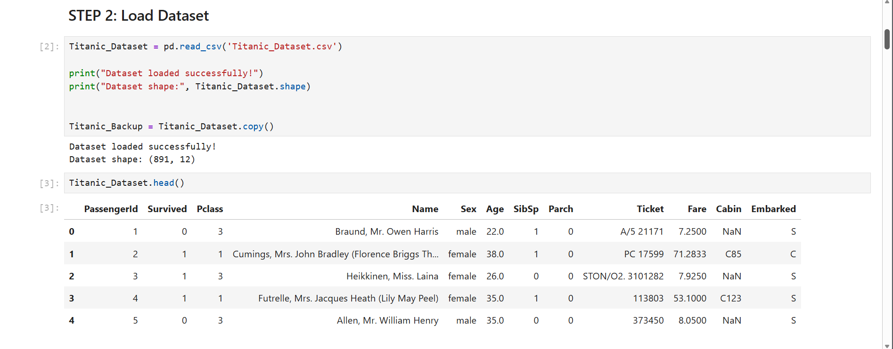
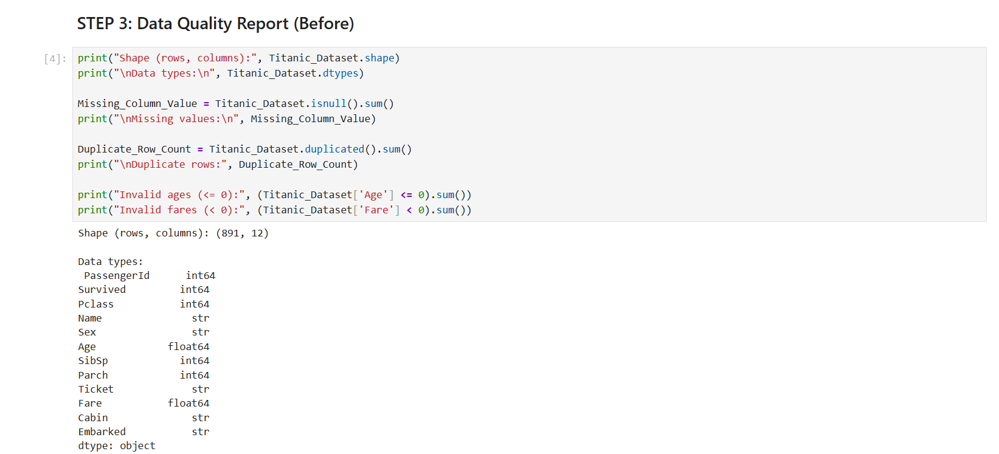
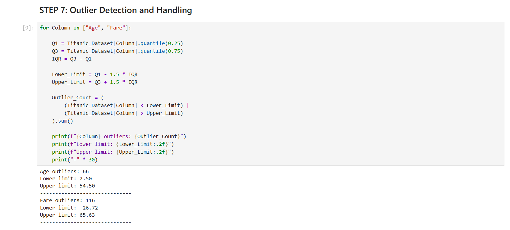
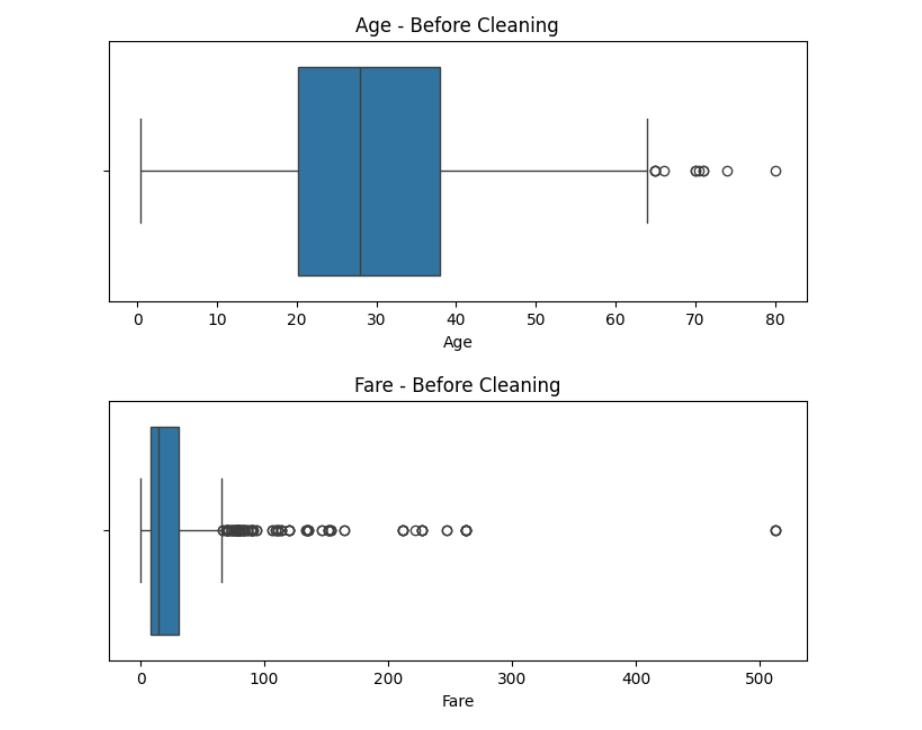
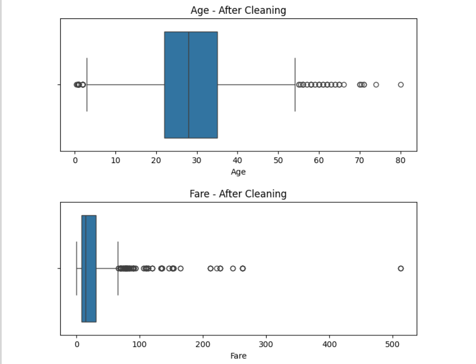
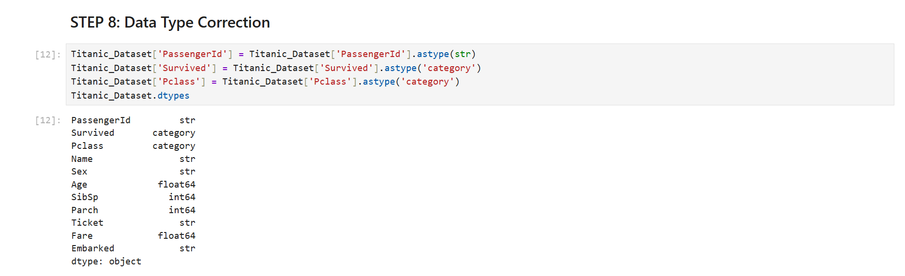
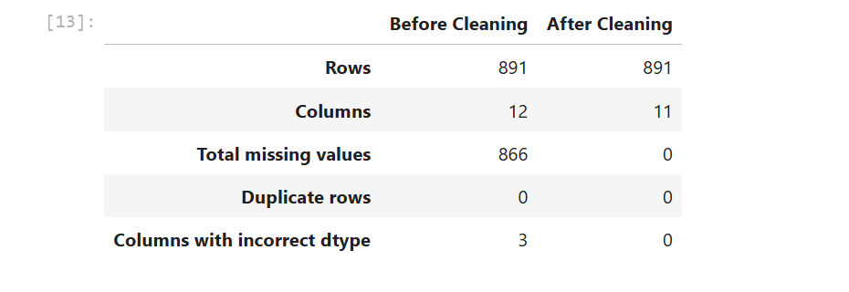
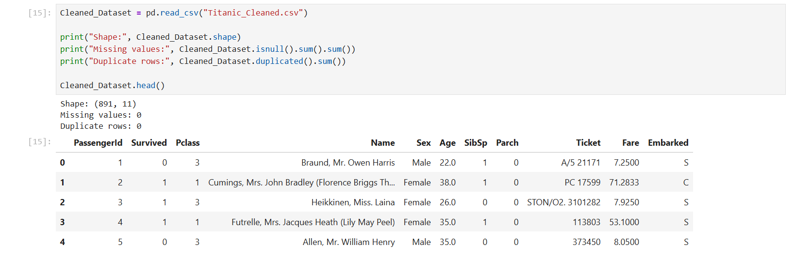

# Data Cleaning

**Organization:** Oasis Infobyte Internship
**Track:** Data Analytics | **Level 1 - Task 3:** Data Cleaning

**Intern:** Mohamed Rabbani

## Objective
Clean the Titanic dataset by finding data quality issues, handling missing
values, removing duplicates, standardizing text, detecting outliers and
correcting data types.

## Tools
Python, Pandas, NumPy, Matplotlib, Seaborn, Jupyter Notebook

## Dataset
Titanic dataset (891 rows, 12 columns) from Kaggle.

> **Note:** The Titanic dataset has no duplicate rows and no date columns,
> so those checks were performed and documented, with no changes needed.

---

## Cleaning Steps

| Step | Action | Result |
|---|---|---|
| 1 | Data quality report | Age: 177, Cabin: 687, Embarked: 2 missing values |
| 2 | Missing values | Age filled with median, Embarked with mode, Cabin dropped |
| 3 | Duplicate removal | 0 duplicate rows found |
| 4 | Text standardization | Sex labels cleaned, Embarked codes mapped to port names |
| 5 | Outlier detection (IQR) | Age: 66, Fare: 116 outliers, retained as genuine values |
| 6 | Data type correction | PassengerId to string, Survived and Pclass to category |
| 7 | Export | Titanic_Cleaned.csv saved |

### Why these decisions?
- **Age (median):** Median is not affected by extreme values.
- **Embarked (mode):** Categorical column, only 2 values were missing.
- **Cabin (dropped):** More than 75% of values were missing.
- **Outliers retained:** Extreme ages and high fares are genuine
  (infants, elderly passengers, first-class tickets), not data errors.

---

## Before vs After Cleaning

| Metric | Before | After |
|---|---|---|
| Rows | 891 | 891 |
| Columns | 12 | 11 |
| Total missing values | 866 | 0 |
| Duplicate rows | 0 | 0 |
| Columns with incorrect dtype | 3 | 0 |

---

## Screenshots

### Load Dataset

### Data Quality Report

### Outlier Count (IQR Method)

### Outliers Before Cleaning

### Outliers After Cleaning

### Data Types Corrected

### Before vs After Summary

### Final Verification

---

## Files in this Folder

| File | Description |
|---|---|
| `Data_Cleaning.ipynb` | Complete cleaning notebook |
| `Titanic_Dataset.csv` | Raw dataset |
| `Titanic_Cleaned.csv` | Cleaned, analysis-ready dataset |
| `screenshots/` | Output screenshots |

## How to Run
1. Download this folder.
2. Install the libraries: `pip install pandas numpy matplotlib seaborn jupyter`
3. Open `Data_Cleaning.ipynb` in Jupyter Notebook.
4. Run **Kernel, then Restart and Run All Cells**.

## Key Learnings
- Choosing the right strategy for each column's missing values.
- Using the IQR method to detect outliers and deciding when to retain them.
- Documenting every cleaning decision clearly.
