# Retail Sales EDA

**Oasis Infobyte Internship | Data Analytics Track | Level 1, Task 1**

**Intern:** Mohamed Rabbani

## Project Overview

This project performs Exploratory Data Analysis (EDA) on a retail sales dataset to find sales trends, understand customer behaviour, and give business recommendations.

## Dataset

- **Source:** Retail_Sales_Dataset (Kaggle, Mohammad Talib)
- **Size:** 1000 transactions, 9 columns
- **Period:** 1 January 2023 to 1 January 2024
- **Columns:** Transaction ID, Date, Customer ID, Gender, Age, Product Category, Quantity, Price per Unit, Total Amount
- **Data quality:** No missing values and no duplicate rows
  
  > **Note:** The dataset has no product names, so product analysis is done at category level.

## Tools Used

Python, Pandas, NumPy, Matplotlib, Seaborn, Jupyter Notebook

## Project Files

| File | Description |
|---|---|
| `EDA_Retails_Sales.ipynb` | Full analysis notebook |
| `Retail_Sales_Dataset.csv` | Dataset |
| `screenshots/` | Outputs and charts |

## Analysis Steps

1. Data loading and initial inspection
2. Data preparation (date conversion, month and quarter columns, age groups)
3. Descriptive statistics (mean, median, mode, standard deviation)
4. Time series analysis (monthly and quarterly sales)
5. Customer demographics (age group and gender)
6. Product analysis (revenue and quantity by category)
7. Correlation analysis
8. Extra visualisations (age group vs category, gender vs category)
9. Conclusion and recommendations

## Key Findings

- **Total sales:** 456,000 from 1000 transactions.
- **Top category:** Electronics earned the highest revenue (156,905) and Beauty the lowest (143,515). All three categories are close.
- **Best-selling by quantity:** Clothing sold the most units (894).
- **Monthly trend:** Sales peaked in May 2023 (53,150) and were lowest in September 2023 (23,620).
- **Quarterly trend:** Q4 was the strongest quarter and Q3 the weakest.
- **Customers:** The 46-55 age group spent the most. Female customers spent slightly more (232,840) than male customers (223,160).
- **Correlation:** Price per Unit has a strong positive correlation with Total Amount (0.85). Age has almost no relationship with spending.
- **Distribution:** The mean transaction amount (456) is higher than the median (135), so a few high-value purchases pull the average up.

## Recommendations

1. Promote Electronics and Clothing with bundle offers, as they bring the highest revenue.
2. Plan stock and discounts around peak (May) and slow (September) periods.
3. Target age groups by category, for example Clothing for ages 26-35 and Beauty offers for ages 56-64.
4. Start a loyalty programme, as all 1000 transactions are from unique customers.

## Screenshots

### Data Overview
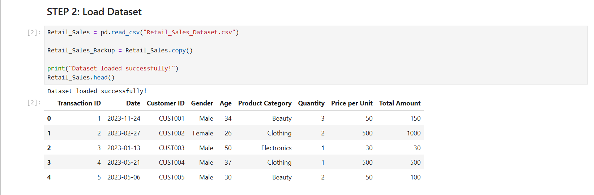
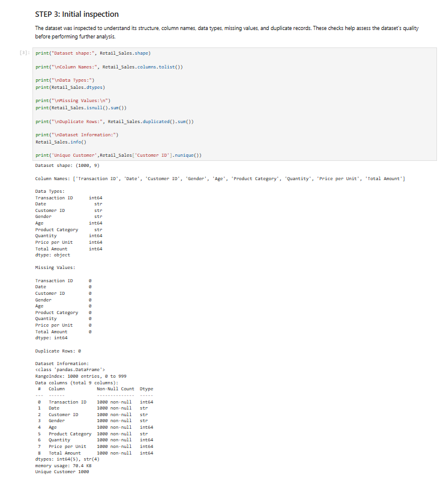
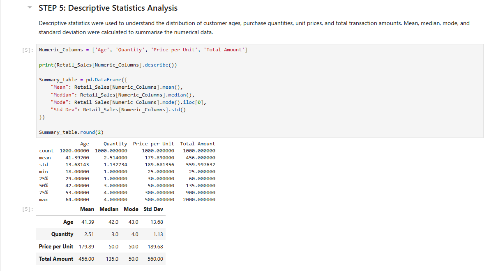

### Time Series Analysis
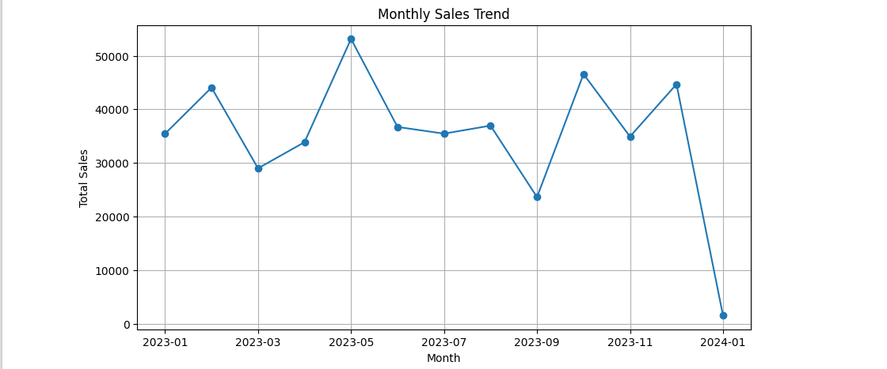
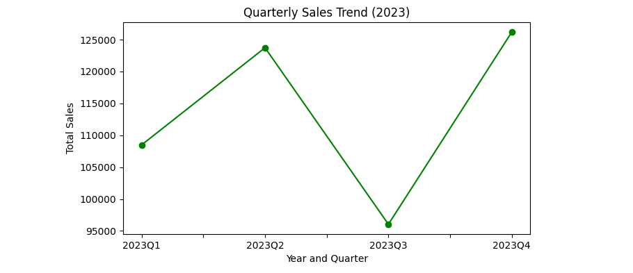

### Customer Demographics
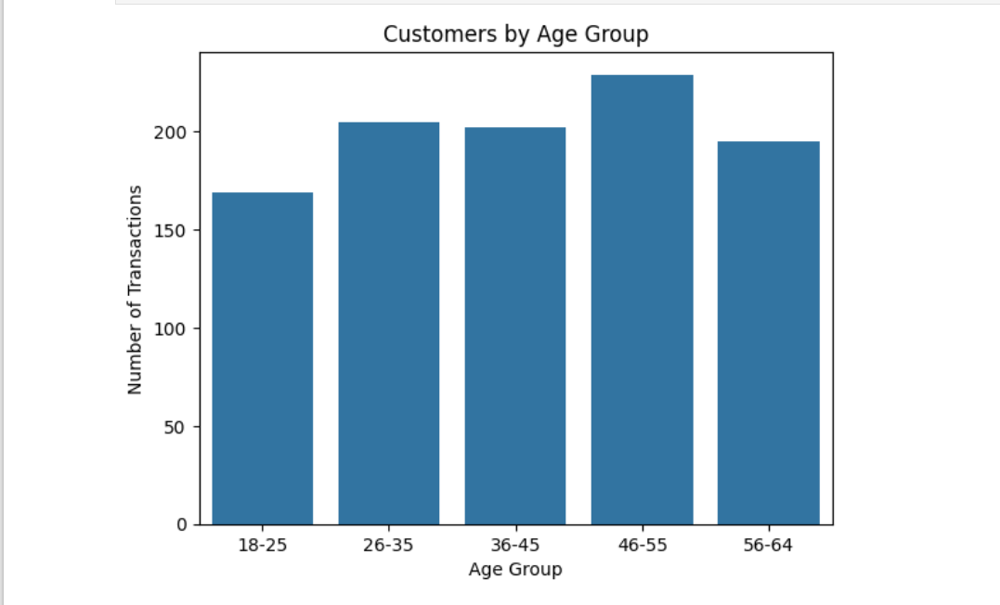
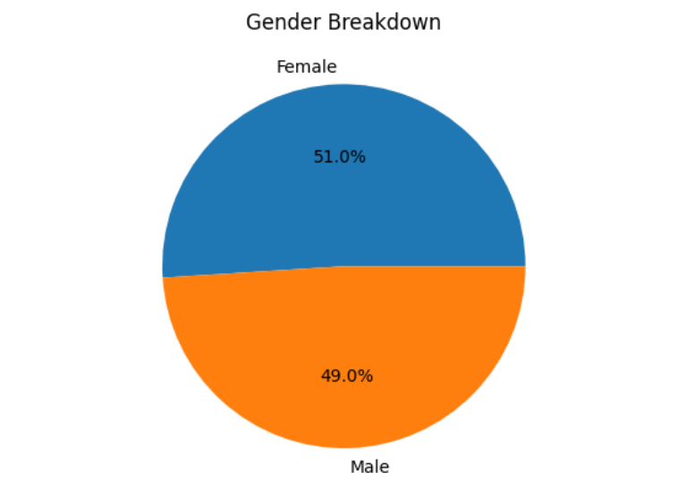

### Product Analysis
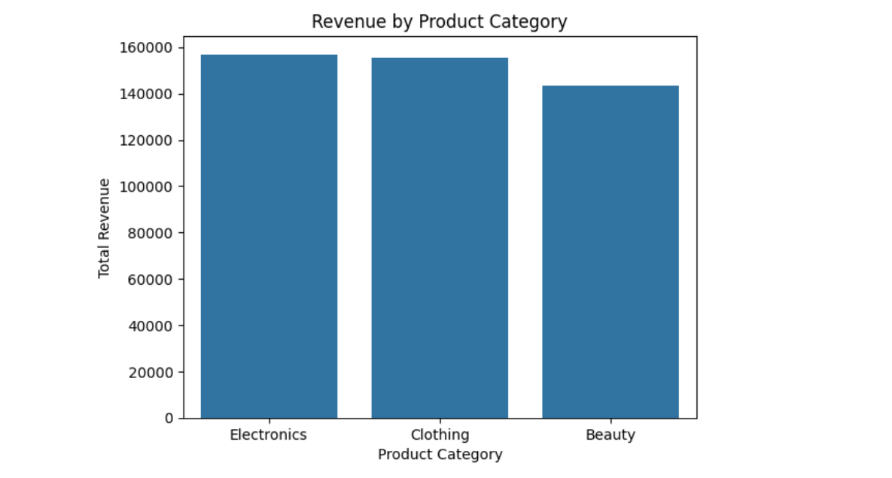
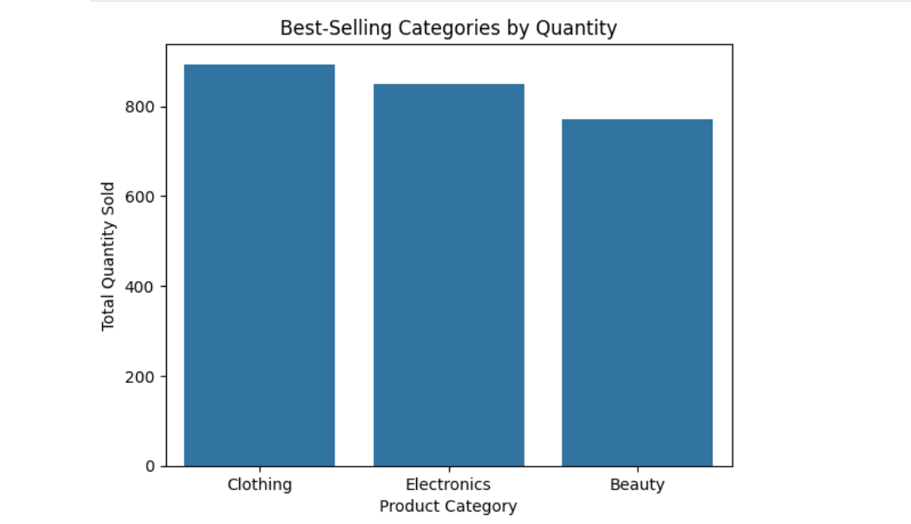

### Correlation and Spending Analysis
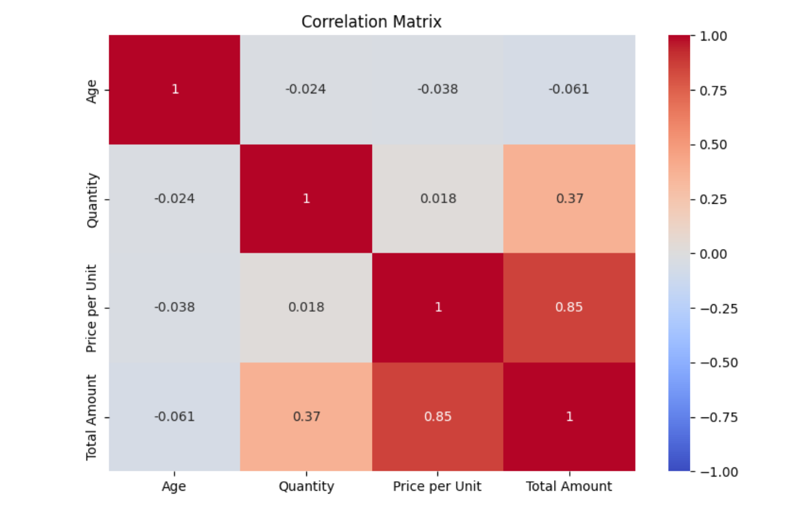
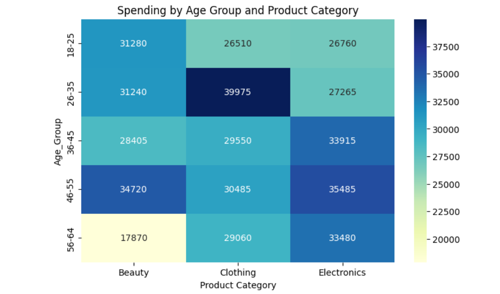
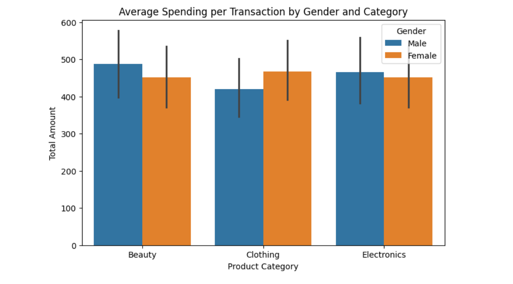

### Final Insights
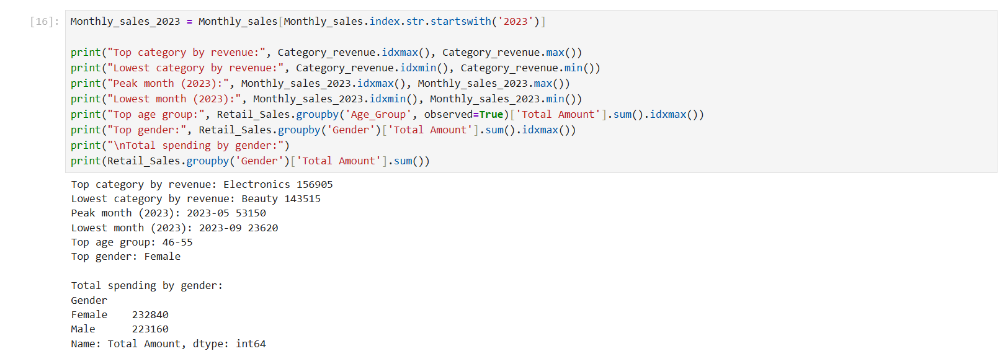

## How to Run

1. Clone this repository.
2. Install the libraries: `pip install pandas numpy matplotlib seaborn`
3. Open `EDA_Retails_Sales.ipynb` in Jupyter Notebook and run all cells.
